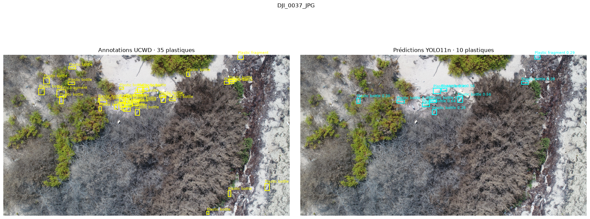
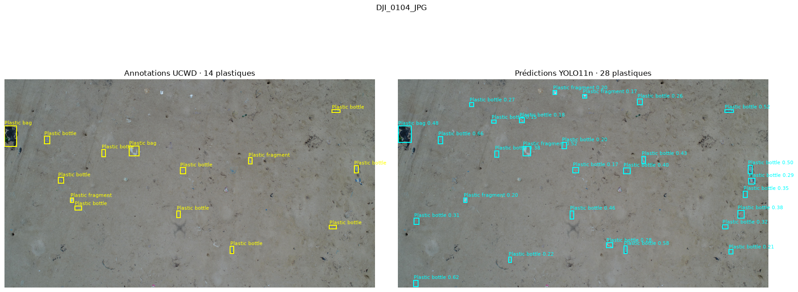

[Français](#détection-de-déchets-plastiques-sur-des-images-aériennes) · [English](#plastic-waste-detection-in-aerial-images)

# Détection de déchets plastiques sur des images aériennes

Ce projet utilise YOLO11n pour localiser des déchets côtiers sur des images de drone et estimer le nombre d’objets en plastique par photo. Le modèle détecte les sept classes d’UCWD. L’analyse du comptage porte sur quatre classes : bouteilles, sacs, contenants et fragments de plastique.

## Objectif d’apprentissage et utilisation de l’IA

J’ai réalisé ce projet comme une première expérimentation personnelle en deep learning pour comprendre les étapes d’un projet de détection d’objets : explorer des images annotées, adapter un modèle préentraîné, choisir un seuil de confiance et interpréter les résultats. J’ai utilisé ChatGPT pour m’aider à écrire les notebooks.

## Matériel et pistes à tester

J’ai fait tourner cette première expérience sur mon ordinateur portable, équipé d’une NVIDIA GeForce RTX 3050 Laptop avec 4 Go de mémoire graphique dédiée. Les 30 époques ont pris environ 4 h 06 avec YOLO11n, des images redimensionnées à 640 pixels et des lots de 4 images.

Un GPU plus rapide pourrait réduire le temps d’entraînement. Davantage de mémoire graphique permettrait aussi de tester une résolution d’entrée plus élevée, par exemple 960 pixels, ou un modèle plus grand. Une résolution plus élevée pourrait préserver davantage de détails sur les petits objets. Il faudrait comparer les configurations dans les mêmes conditions pour mesurer l’effet sur la détection et le comptage.

## Résultats

J’ai adapté un YOLO11n préentraîné sur COCO pendant 30 époques (640 pixels, lots de 4, graine aléatoire 42). J’ai choisi le seuil de confiance de 0,15 pour le comptage sur le jeu de validation, en comparant les erreurs obtenues à 0,15 et 0,25.

| Indicateur | Validation (500 images) | Test (500 images) |
| --- | ---: | ---: |
| mAP@0.50 (sept classes) | 0,750 | 0,748 |
| mAP@0.50:0.95 (sept classes) | 0,463 | 0,458 |
| Objets en plastique annotés (quatre classes) | 2 038 | 2 235 |
| Objets en plastique prédits au seuil de 0,15 | 2 008 | 2 059 |
| Erreur absolue moyenne de comptage (objets par image) | 1,256 | 1,380 |

Sur les images de test, le total prédit est inférieur de **176 objets** au total annoté (7,9 %). Les bouteilles contribuent le plus à cet écart, avec 1 330 prédictions pour 1 434 annotations. L’erreur absolue moyenne mesure l’écart sur chaque photo, avant de faire la moyenne.

## Exemples d’erreurs

**Sous-comptage — `DJI_0037`.** On compte 35 objets annotés et 10 prédits. Plusieurs bouteilles annotées en bas à droite n’ont pas de prédiction à proximité.

**Surcomptage — `DJI_0104`.** On compte 14 objets annotés et 28 prédits. Plusieurs boîtes prédites comme des bouteilles n’ont pas d’annotation visible correspondante.

Les figures comparent les annotations UCWD aux prédictions du projet au seuil de 0,15. Les images et les annotations proviennent du [Unified Coastal Waste Dataset v1.0](https://doi.org/10.5281/zenodo.20630252), constitué par Hesam Hatamzadeh Khanghahi et distribué sous licence [CC BY 4.0](https://creativecommons.org/licenses/by/4.0/).

## Reproduire l’expérience

1. Télécharger la version YOLO d’[UCWD v1.0](https://doi.org/10.5281/zenodo.20630252) et l’extraire dans `data/raw/ucwd/UCWD.yolo/`. Le découpage d’origine contient 3 071 images d’entraînement, 500 de validation et 500 de test.
2. Utiliser un kernel Jupyter Python 3.11 avec Ultralytics, PyTorch, pandas et Matplotlib. L’expérience a utilisé Python 3.11.7, Ultralytics 8.4.216 et PyTorch 2.15.0 avec CUDA 13.2.
3. Indiquer le chemin local du dataset dans `configs/ucwd.yaml` et adapter les chemins absolus éventuels dans les notebooks. L’évaluation sur GPU utilise `device=0`.
4. Exécuter les notebooks dans l’ordre. Le notebook d’entraînement génère `results/training/yolo11n_baseline_640/weights/best.pt`, que le notebook d’évaluation recharge.

| Notebook | Rôle |
| --- | --- |
| `01_exploratory_data_analysis.ipynb` | Explorer les images, les classes, les boîtes et le chevauchement entre les lots |
| `02_data_preprocessing.ipynb` | Vérifier les données et préparer la configuration |
| `03_baseline_training.ipynb` | Adapter YOLO11n et sauvegarder les meilleurs poids |
| `04_evaluation.ipynb` | Évaluer la détection et le comptage, puis examiner des erreurs |

## Limites de l’évaluation

L’expérience conserve le découpage d’origine d’UCWD. L’analyse exploratoire n’a détecté aucun doublon binaire exact entre les lots, mais les 23 séquences vidéo identifiées apparaissent chacune dans plusieurs lots. Des images proches peuvent montrer la même scène ou le même objet. Les scores décrivent donc les performances sur le découpage UCWD utilisé et peuvent surestimer celles sur de nouveaux vols. Pour mesurer cette généralisation, une prochaine expérience pourrait attribuer chaque séquence vidéo entière à un seul lot avant de réentraîner le modèle.

---

# Plastic Waste Detection in Aerial Images

This project uses YOLO11n to locate coastal litter in drone images and estimate how many plastic objects appear in each photo. The model detects seven UCWD classes. The counting analysis focuses on plastic bottles, bags, containers, and fragments.

## Learning project and use of AI

I built this as a hands-on deep learning experiment to understand the full workflow: inspecting annotated images, fine-tuning a detector, choosing a confidence threshold, and interpreting the results. I used ChatGPT to help write the notebook code.

## Hardware and follow-up experiments

I ran the first experiment locally on a laptop with an NVIDIA GeForce RTX 3050 Laptop GPU (4 GB of dedicated graphics memory). The 30-epoch training run took about 4 hours and 6 minutes with YOLO11n, 640-pixel inputs, and batches of 4 images.

A faster GPU could reduce training time, and more graphics memory would make it easier to test larger inputs (for example, 960 pixels) or a larger model. Higher-resolution inputs could help preserve detail for small objects. Any improvement in detection or counting would need to be measured in a controlled comparison.

## Results

YOLO11n was fine-tuned from COCO-pretrained weights for 30 epochs at an input size of 640 pixels with a batch size of 4 and seed 42. The confidence threshold for counting (0.15) was selected on the validation split by comparing the mean absolute counting error at 0.15 and 0.25.

| Metric | Validation (500 images) | Test (500 images) |
| --- | ---: | ---: |
| mAP@0.50 (seven classes) | 0.750 | 0.748 |
| mAP@0.50:0.95 (seven classes) | 0.463 | 0.458 |
| Annotated plastic objects (four classes) | 2,038 | 2,235 |
| Predicted plastic objects at confidence 0.15 | 2,008 | 2,059 |
| Mean absolute counting error (objects per image) | 1.256 | 1.380 |

On the test split, the model counted **176 fewer plastic objects than annotated** overall (7.9%). Bottles contributed the largest share of that gap, with 1,330 predictions and 1,434 annotations. Mean absolute counting error is calculated per image, so overcounts and undercounts on different photos cannot cancel each other out in that metric.

## Example errors

**Undercounting — `DJI_0037`.** The reference contains 35 plastic objects and the model predicts 10. Several annotated bottles in the lower-right area have no nearby prediction.

**Overcounting — `DJI_0104`.** The reference contains 14 plastic objects and the model predicts 28. Several predicted bottle boxes have no matching visible annotation.

Both figures compare UCWD annotations with predictions from this project at confidence 0.15. Source imagery and annotations are from [Unified Coastal Waste Dataset v1.0](https://doi.org/10.5281/zenodo.20630252), curated by Hesam Hatamzadeh Khanghahi and distributed under [CC BY 4.0](https://creativecommons.org/licenses/by/4.0/).

## Reproduce the experiment

1. Download the YOLO version of [UCWD v1.0](https://doi.org/10.5281/zenodo.20630252) and extract it under `data/raw/ucwd/UCWD.yolo/`. The original split sizes are 3,071 training, 500 validation, and 500 test images.
2. Use a Python 3.11 Jupyter kernel with Ultralytics, PyTorch, pandas, and Matplotlib. The reported run used Python 3.11.7, Ultralytics 8.4.216, and PyTorch 2.15.0 with CUDA 13.2 on an RTX 3050 Laptop GPU (4 GB).
3. Set the dataset root in `configs/ucwd.yaml` to your local dataset directory. If the notebooks use an absolute project path, update it to point to your clone. GPU evaluation uses `device=0`.
4. Run the notebooks in order. The training notebook produces `results/training/yolo11n_baseline_640/weights/best.pt`, which the evaluation notebook loads.

| Notebook | Purpose |
| --- | --- |
| `01_exploratory_data_analysis.ipynb` | Inspect the images, class distribution, bounding boxes, and split overlap |
| `02_data_preprocessing.ipynb` | Check the dataset and prepare its configuration |
| `03_baseline_training.ipynb` | Fine-tune YOLO11n and save the best weights |
| `04_evaluation.ipynb` | Measure detection and counting performance, and inspect example errors |

## Evaluation limits

The original UCWD splits were kept for this baseline. The exploratory analysis found no exact binary duplicates across splits, but all 23 identified video sequences appeared in more than one split. Nearby frames can show the same scene or object, so these scores describe the original UCWD split and may overestimate performance on entirely new flights. To measure that generalization, a follow-up experiment would keep each video sequence in a single split before retraining.
